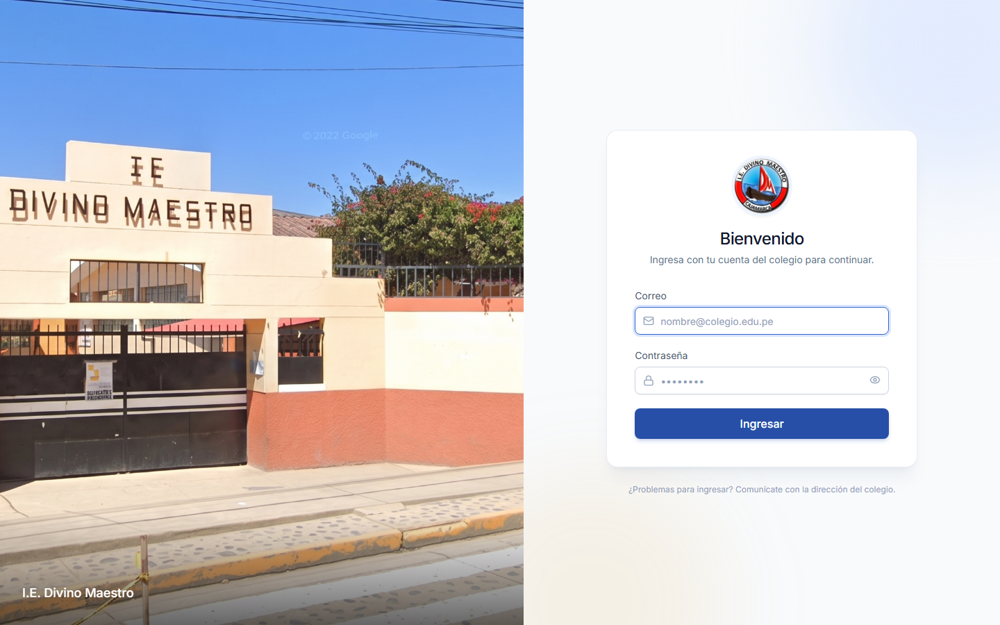
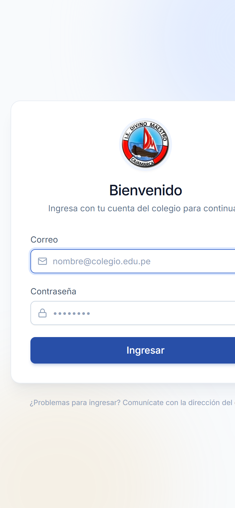
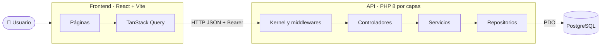

<!-- Encabezado animado -->
<p align="center">
  
</p>

<p align="center">
  <a href="#-puesta-en-marcha">
    
  </a>
</p>

<p align="center">
  
  
  
  
  <br />
  
  
  
  
</p>

<br />

<table align="center">
  <tr>
    <td align="center" width="760">
      <h3>🤝 Proyecto en colaboración</h3>
      <p>
        <b>Novatec</b> colaboró en el desarrollo de este sistema para <b>Diego Álvarez</b>,<br />
        como parte de su <b>proyecto de mejora en una empresa</b>, con el que culminará su carrera y obtendrá su título.
      </p>
      <sub>Institución beneficiada: <b>I.E. Divino Maestro</b></sub>
    </td>
  </tr>
</table>

<br />

<p align="center">
  
</p>

---

## 📑 Contenido

- [✨ Qué hace](#-qué-hace)
- [📸 Capturas](#-capturas)
- [🧰 Tecnologías](#-tecnologías)
- [🏗️ Arquitectura](#️-arquitectura)
- [🚀 Puesta en marcha](#-puesta-en-marcha)
- [🤖 Guía para asistentes de IA](#-guía-para-asistentes-de-ia)
- [🗄️ Base de datos](#️-base-de-datos)
- [🔐 Roles y permisos](#-roles-y-permisos)
- [📁 Estructura del proyecto](#-estructura-del-proyecto)
- [🧪 Pruebas y calidad](#-pruebas-y-calidad)
- [🛠️ Problemas frecuentes](#️-problemas-frecuentes)
- [👥 Créditos](#-créditos)

---

## ✨ Qué hace

Sistema web para la gestión administrativa de un colegio: reemplaza las hojas de Excel por una aplicación con control de acceso, historial y reportes.

<table>
  <tr>
    <td width="50%" valign="top">

**🎓 Estudiantes y familias**
- Ficha del estudiante con familia, matrículas, hermanos y pagos.
- Padres, madres, apoderados y contactos de emergencia.
- Estados académicos: activo, retirado o trasladado.

**📝 Matrículas**
- Alta del estudiante y su familia en un solo paso.
- Copia la familia de un hermano ya registrado.
- Nivel → grado → sección en cascada.

  </td>
  <td width="50%" valign="top">

**💳 Pagos y cobranza**
- Conceptos por estudiante o por familia.
- Abonos parciales con saldo pendiente por cuenta.
- Panel con ingresos mensuales y avance de cobranza.

**📚 Académico y dirección**
- Cursos, periodos y registro de notas.
- Asistentes con permisos individuales.
- Auditoría de cada acción, con usuario, fecha e IP.

  </td>
  </tr>
</table>

> [!TIP]
> Toda la interfaz está en español, funciona en celular y confirma cada acción importante con alertas (SweetAlert2).

---

## 📸 Capturas

<table>
  <tr>
    <td width="72%"></td>
    <td width="28%"></td>
  </tr>
  <tr>
    <td align="center"><sub>Inicio de sesión</sub></td>
    <td align="center"><sub>Vista en celular</sub></td>
  </tr>
</table>

<!-- CAPTURAS_INTERNAS -->

---

## 🧰 Tecnologías

<p align="center">
  <a href="https://skillicons.dev">
    
  </a>
</p>

| Capa | Tecnología | Para qué se usa |
|---|---|---|
| **Frontend** | [React 19](https://react.dev) + [TypeScript](https://www.typescriptlang.org) | Interfaz de una sola página (SPA) |
| | [Vite 8](https://vite.dev) | Servidor de desarrollo y compilación |
| | [Tailwind CSS 4](https://tailwindcss.com) | Estilos y sistema de diseño |
| | [React Router](https://reactrouter.com) | Navegación entre módulos |
| | [TanStack Query 5](https://tanstack.com/query) | Consultas a la API con caché |
| | [Recharts 3](https://recharts.org) | Gráficos del panel |
| | [SweetAlert2](https://sweetalert2.github.io) | Confirmaciones y avisos |
| | [Lucide](https://lucide.dev) | Íconos |
| **Backend** | PHP 8.2+ (sin framework) | API REST por capas |
| | PDO + PostgreSQL | Acceso a datos con consultas preparadas |
| | GD | Recorte y conversión a WebP de las fotos de perfil |
| | Composer + PHPUnit 11 | Dependencias y pruebas |
| **Base de datos** | PostgreSQL 15+ (probado en 18) | Datos del colegio |

---

## 🏗️ Arquitectura



- **Frontend** (`frontend/`): SPA que consume `/api/v1`. En desarrollo, Vite reenvía `/api` y `/uploads` a la API, así que no hace falta configurar CORS.
- **API** (`src/`): `Router → Middlewares (auth, rol, permiso) → Controlador → Servicio → Repositorio`. Contenedor de dependencias propio, validación centralizada y respuestas JSON uniformes.
- **Autenticación**: tokens Bearer guardados como hash en la tabla `api_token`; vencen tras horas de inactividad y se revocan al cerrar sesión o cambiar la contraseña.

📘 Detalle completo de capas, seguridad y endpoints: [`ARQUITECTURA.md`](ARQUITECTURA.md).

---

## 🚀 Puesta en marcha

### Requisitos

| Herramienta | Versión | Comprobar con |
|---|---|---|
| PHP | 8.2 o superior, con `pdo_pgsql`, `mbstring` y `gd` | `php -v` · `php -m` |
| Composer | 2.x | `composer -V` |
| PostgreSQL | 15 o superior | `psql --version` |
| Node.js | 20 o superior | `node -v` |

> [!NOTE]
> En Windows, [Laragon](https://laragon.org) trae PHP y Composer. Activa `extension=pdo_pgsql` y `extension=gd` en `php.ini`.

### 1. Instalar dependencias

```bash
composer install
cd frontend && npm install && cd ..
```

### 2. Configurar el entorno

```bash
cp .env.example .env
```

Completa `.env` con los datos de tu PostgreSQL:

| Variable | Ejemplo | Descripción |
|---|---|---|
| `DB_HOST` | `127.0.0.1` | Servidor de PostgreSQL |
| `DB_PORT` | `5432` | Puerto |
| `DB_NAME` | `db_apafa_colegio` | Nombre de la base |
| `DB_USER` | `postgres` | Usuario |
| `DB_PASSWORD` | — | Contraseña |
| `APP_DEBUG` | `true` | Muestra el error real en respuestas 500 (solo desarrollo) |
| `APP_CORS_ORIGINS` | `http://localhost:5173` | Orígenes permitidos del frontend |
| `APP_TOKEN_HORAS` | `12` | Horas de inactividad antes de vencer la sesión |

### 3. Crear la base de datos

Elige **una** de las dos opciones:

```bash
# Opción A — importar el volcado (estructura + catálogos)
createdb -U postgres db_apafa_colegio
psql -U postgres -d db_apafa_colegio -f database/sistema_escolar.sql

# Opción B — crearla con las migraciones del proyecto
createdb -U postgres db_apafa_colegio
php bin/migrar.php
```

### 4. Crear el primer usuario

```bash
php bin/crear-usuario.php director@colegio.pe "Nombre del Director" director
```

El comando muestra una contraseña generada; también puedes pasarla como cuarto argumento. Roles válidos: `director`, `asistente`, `hiperadmin`.

### 5. Levantar el sistema

Abre dos terminales:

```bash
# Terminal 1 — API en http://127.0.0.1:8000
composer servir
```

```bash
# Terminal 2 — Frontend en http://localhost:5173
cd frontend
npm run dev
```

Entra a **http://localhost:5173** con el usuario del paso 4. 🎉

---

## 🤖 Guía para asistentes de IA

> [!IMPORTANT]
> Esta sección está pensada para que un agente de IA (Claude Code, Codex, Cursor, Copilot…) levante el proyecto sin intervención. Las mismas reglas están en [`AGENTS.md`](AGENTS.md).

**Orden exacto de pasos**

1. Verifica requisitos: `php -v` (≥ 8.2), `php -m` debe listar `pdo_pgsql` y `gd`, `node -v` (≥ 20), `psql --version`.
2. `composer install` en la raíz y `npm install` en `frontend/`.
3. Si no existe `.env`, cópialo de `.env.example` y **pide al usuario** la contraseña de PostgreSQL. No inventes credenciales.
4. Crea la base `db_apafa_colegio` (o la que diga `DB_NAME`) y ejecuta `php bin/migrar.php`. Debe terminar sin errores; ejecutarlo dos veces no hace nada (las migraciones quedan registradas en `schema_migracion`).
5. Crea un usuario con `php bin/crear-usuario.php` y entrega la contraseña al usuario.
6. Inicia la API con `composer servir` (puerto 8000) y el frontend con `npm run dev` dentro de `frontend/` (puerto 5173). Ambos son procesos que no terminan: ejecútalos en segundo plano.
7. Comprueba:
   - `curl http://127.0.0.1:8000/api/v1/auth/yo` → **401** (la API responde y exige token).
   - `http://localhost:5173` muestra la pantalla de inicio de sesión.
   - `composer test` → todas las pruebas en verde.
   - `cd frontend && npm run typecheck` → sin errores.

**Reglas del proyecto**

- Nunca subas `.env`, `doc-exel/`, `database/respaldo/` ni `public/uploads/`: contienen credenciales o datos personales.
- Los cambios de base de datos van en un archivo nuevo `database/migraciones/NNN_descripcion.sql` (idempotente, con `IF NOT EXISTS`); nunca edites una migración ya aplicada.
- La API responde `{ "data": ... }` o `{ "error": { "mensaje", "campos" } }`; los listados paginados añaden `meta`.
- Textos de la interfaz en español. Componentes base en `frontend/src/components/ui/`; alertas solo con `frontend/src/lib/alertas.ts`.

---

## 🗄️ Base de datos

| Archivo | Contenido | ¿Se sube a Git? |
|---|---|---|
| `database/sistema_escolar.sql` | Volcado de la estructura + catálogos (años, niveles, grados, secciones, permisos, conceptos de pago). Sin datos personales. | ✅ Sí |
| `database/schema.sql` · `permissions.sql` · `migraciones/` | Esquema base y migraciones que aplica `bin/migrar.php`. | ✅ Sí |
| `database/respaldo/*.dump` | Respaldo completo con datos reales (formato `pg_dump -Fc`). | ❌ No |

Restaurar un respaldo completo:

```bash
pg_restore -U postgres -d db_apafa_colegio --no-owner database/respaldo/db_apafa_colegio_AAAAMMDD.dump
```

<details>
<summary><b>Tablas principales</b></summary>

| Tabla | Descripción |
|---|---|
| `usuario`, `permisos`, `usuario_permisos`, `api_token` | Cuentas, permisos y sesiones |
| `estudiante`, `responsable`, `estudiante_responsable` | Alumnos y sus familias |
| `anio`, `nivel`, `grado`, `seccion`, `grado_seccion` | Catálogos académicos |
| `matricula` | Matrícula de un estudiante en un año y sección |
| `concepto_pago`, `cuenta_pago`, `pago` | Qué se cobra, cuánto se debe y qué se pagó |
| `curso`, `periodo_academico`, `calificacion` | Notas |
| `auditoria_movimiento` | Historial de acciones |
| `schema_migracion` | Migraciones aplicadas |

</details>

---

## 🔐 Roles y permisos

| Rol | Puede |
|---|---|
| 👑 **Director** / **Hiperadmin** | Todo: además administra asistentes y revisa la auditoría |
| 🧑‍💼 **Asistente** | Ver información y solo lo que el director le habilite |

| Permiso | Habilita |
|---|---|
| `p_matricular` | Matrículas, edición de estudiantes, cursos, periodos y notas |
| `p_cobrar` | Registrar pagos y administrar conceptos de pago |
| `p_editar` | Crear y editar familias |
| `p_auditoria` | Eliminar registros de auditoría |

---

## 📁 Estructura del proyecto

```text
📦 Sistema_escolar
├── 📂 bin/                  # migrar.php · crear-usuario.php
├── 📂 config/               # rutas.php (todas las rutas de la API)
├── 📂 database/             # esquema, migraciones y volcado
├── 📂 docs/capturas/        # imágenes del README
├── 📂 frontend/             # SPA React + Vite
│   └── 📂 src/
│       ├── 📂 auth/         # sesión y permisos
│       ├── 📂 components/   # tabla, filtros, buscador, ui/*
│       ├── 📂 layout/       # barra lateral y menú de usuario
│       ├── 📂 lib/          # api, alertas, hooks, utilidades
│       └── 📂 pages/        # un directorio por módulo
├── 📂 public/               # index.php (entrada de la API) y fotos subidas
├── 📂 src/                  # código de la API
│   ├── 📂 Auth/             # tokens, roles y permisos
│   ├── 📂 Core/             # configuración, BD, contenedor, paginación
│   ├── 📂 Http/             # kernel, router, middlewares
│   ├── 📂 Modulos/          # Estudiantes, Matriculas, Pagos, Academico…
│   ├── 📂 Soporte/          # dinero, fotos de perfil…
│   └── 📂 Validacion/       # validador de entradas
├── 📂 tests/                # PHPUnit
├── 📄 .env.example
├── 📄 AGENTS.md             # instrucciones para agentes de IA
└── 📄 ARQUITECTURA.md       # detalle técnico y endpoints
```

---

## 🧪 Pruebas y calidad

| Comando | Qué hace |
|---|---|
| `composer test` | Pruebas unitarias de la API (PHPUnit) |
| `composer migrar` | Aplica migraciones pendientes |
| `composer servir` | API en `http://127.0.0.1:8000` |
| `npm run dev` | Frontend con recarga en caliente |
| `npm run typecheck` | Revisión de tipos de TypeScript |
| `npm run build` | Compila el frontend para producción en `frontend/dist/` |

---

## 🛠️ Problemas frecuentes

<details>
<summary><b>❌ <code>could not find driver</code> al migrar</b></summary>

Falta la extensión de PostgreSQL. En `php.ini` descomenta `extension=pdo_pgsql` y reinicia la terminal. Verifica con `php -m | grep pdo_pgsql`.
</details>

<details>
<summary><b>❌ La foto de perfil no se guarda</b></summary>

Activa `extension=gd` en `php.ini` (se usa para recortar la imagen y convertirla a WebP).
</details>

<details>
<summary><b>❌ El frontend muestra “No se pudo conectar con el servidor”</b></summary>

La API no está corriendo o usa otro puerto. Levántala con `composer servir`. Si está en otra dirección, inicia el frontend con `API_URL=http://host:puerto npm run dev`.
</details>

<details>
<summary><b>❌ Error de autenticación de PostgreSQL</b></summary>

Revisa `DB_USER`, `DB_PASSWORD` y `DB_PORT` en `.env`. En algunas instalaciones el puerto no es 5432 (por ejemplo 5433).
</details>

---

## 👥 Créditos

<table align="center">
  <tr>
    <td align="center" width="260">
      <br />
      <sub>Diseño y desarrollo del sistema</sub>
    </td>
    <td align="center" width="260">
      <br />
      <sub>Proyecto de mejora para su titulación</sub>
    </td>
    <td align="center" width="260">
      <br />
      <sub>Institución beneficiada</sub>
    </td>
  </tr>
</table>

<p align="center">
  Hecho con 💙 por <b>Novatec</b> para <b>Diego Álvarez</b> y la comunidad educativa de la <b>I.E. Divino Maestro</b>.
</p>

<p align="center">
  
</p>
